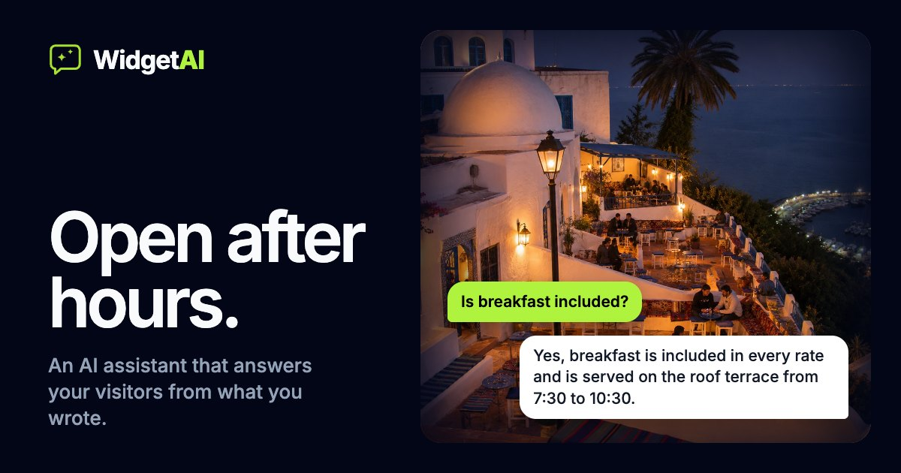

# WidgetAI Landing Page

Public landing page for WidgetAI, built with Astro, TypeScript and plain CSS on the same design tokens as the dashboard.

WidgetAI is a product for creating embeddable AI chat widgets for websites. This repository contains only the marketing and landing page that presents the product. The dashboard, backend, embeddable widget runtime, and AI infrastructure are closed source and are not included here.



## Live URLs

- Landing page: [widgetai.youssef.tn](https://widgetai.youssef.tn)
- Hosted dashboard: [dashboard.widgetai.youssef.tn](https://dashboard.widgetai.youssef.tn/login)

## Repository Scope

This repository includes:

- The public homepage
- Product messaging and marketing sections
- A live demo that talks to a real WidgetAI widget
- Feature highlights and FAQ content
- SEO metadata, social sharing tags, structured data, sitemap support, and robots handling
- Source-managed image assets and public favicon files

This repository does not include:

- User authentication
- The private WidgetAI dashboard
- Backend APIs or database logic
- The embeddable chat widget runtime
- AI provider integrations or business logic

## Features

- Hero built around a night photograph and the visitor's own local time
- Live demo: the widget's full context beside a chat with the real widget, highlighting the line each answer leans on
- The real widget in the corner, loaded after the page finishes loading
- Close-ups of the product's parts, an FAQ written as a conversation, and a copyable install tag
- Structured data for Organization, WebSite, WebPage, SoftwareApplication, and FAQPage
- Sitemap integration and canonical URL support
- Responsive layout across desktop, tablet and phone; all content renders without JavaScript

## Performance

- No UI framework at runtime: one ~4 kB script, CSS inlined into the page
- Self-hosted Inter and JetBrains Mono, with a metric-matched fallback (no layout shift on font swap)
- Responsive AVIF/WebP images through `astro:assets`; the hero is preloaded with high priority

## Tech Stack

- Astro 5
- TypeScript
- Plain CSS (tokens shared with the dashboard)
- ESLint
- Prettier

## Project Structure

```text
.
├── public/              # Favicons, manifest, and browser-discoverable public files
├── src/
│   ├── assets/          # Landing page images managed by Astro
│   ├── components/      # Astro components
│   ├── scripts/         # Client script for the home page
│   ├── layouts/         # Shared Astro layout
│   ├── lib/             # Site config and shared helpers
│   ├── pages/           # Astro routes
│   └── styles/          # Global styles and theme tokens
├── astro.config.mjs
├── package.json
└── project-overview.txt
```

## Getting Started

### Prerequisites

- Bun 1.x

### Installation

```bash
bun install
```

### Run the development server

```bash
bun run dev
```

### Build for production

```bash
bun run build
```

### Preview the production build

```bash
bun run preview
```

## Available Scripts

- `bun run dev` - Start the local development server
- `bun run build` - Create a production build in `dist/`
- `bun run preview` - Preview the production build locally
- `bun run lint` - Run ESLint
- `bun run typecheck` - Run Astro and TypeScript checks
- `bun run format` - Format `*.ts`, `*.tsx`, and `*.astro` files

## Configuration

- `SITE_URL` or `PUBLIC_SITE_URL` can be used at build time to override the canonical site URL
- `PUBLIC_WIDGET_API_URL`, `PUBLIC_WIDGET_ID` and `PUBLIC_DASHBOARD_URL` configure the live widget and dashboard links (defaults are production; see `.env.example`)
- The demo shows the widget's context from `src/lib/guide-context.ts`; keep the widget in `PUBLIC_WIDGET_ID` set to that exact text
- Core site metadata lives in `src/lib/site.ts`
- SEO output is handled through `src/layouts/main.astro` and `@astrojs/sitemap`

## Contributing

Contributions are welcome for the public landing page only. Good contribution areas include:

- Copy and messaging improvements
- Visual polish and responsive refinements
- Accessibility improvements
- Performance work
- SEO and metadata improvements

Please keep pull requests scoped to the open source landing page in this repository.

## Author

Built by Youssef Dhibi.

## License

This repository is licensed under the MIT License. See [LICENSE](LICENSE).

The MIT license applies only to the files contained in this repository. The private WidgetAI dashboard, backend services, embeddable runtime, and other closed source product components are not part of this repository or this license.
